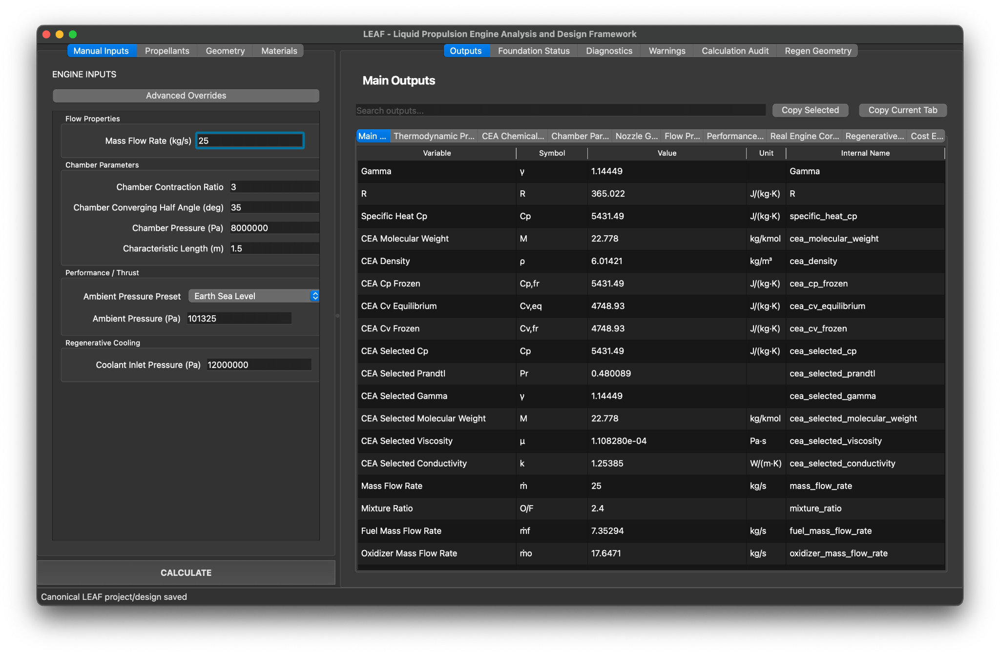
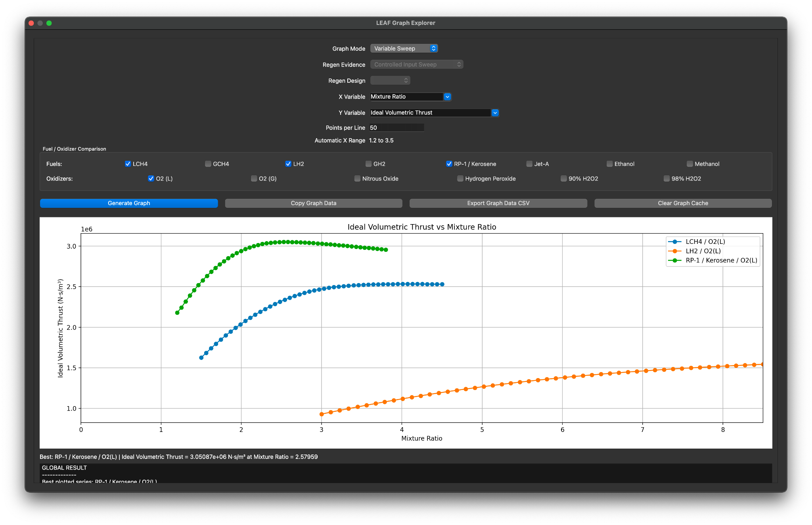
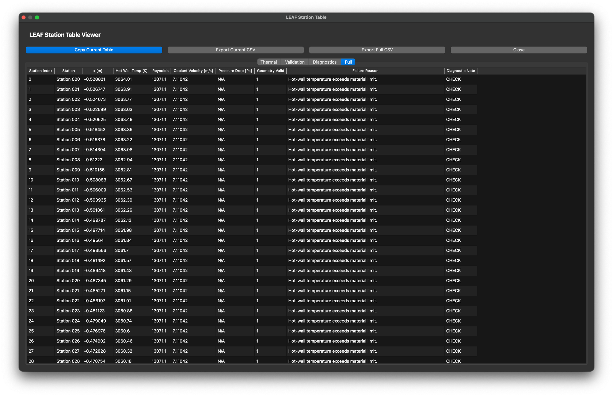
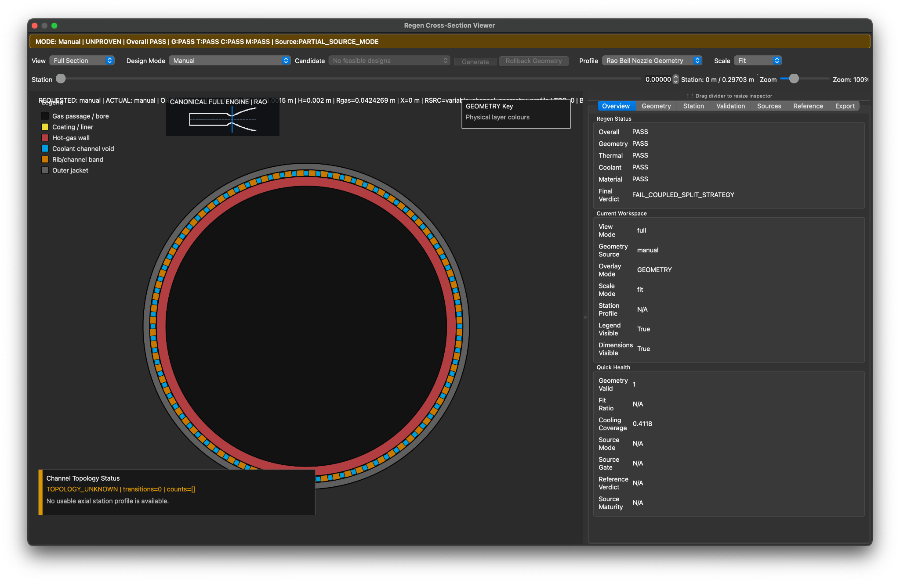
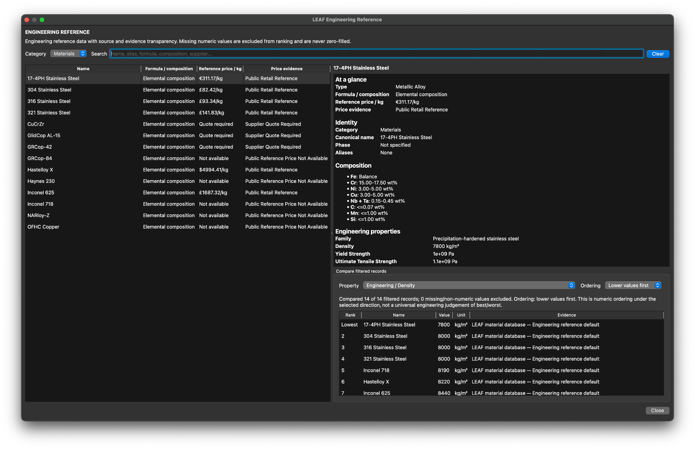
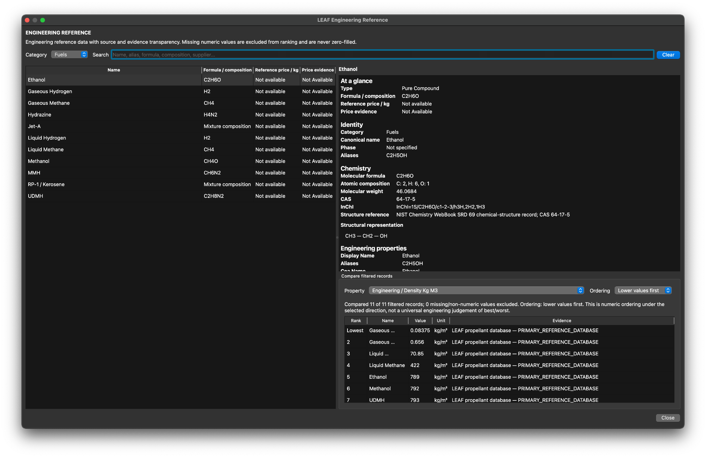
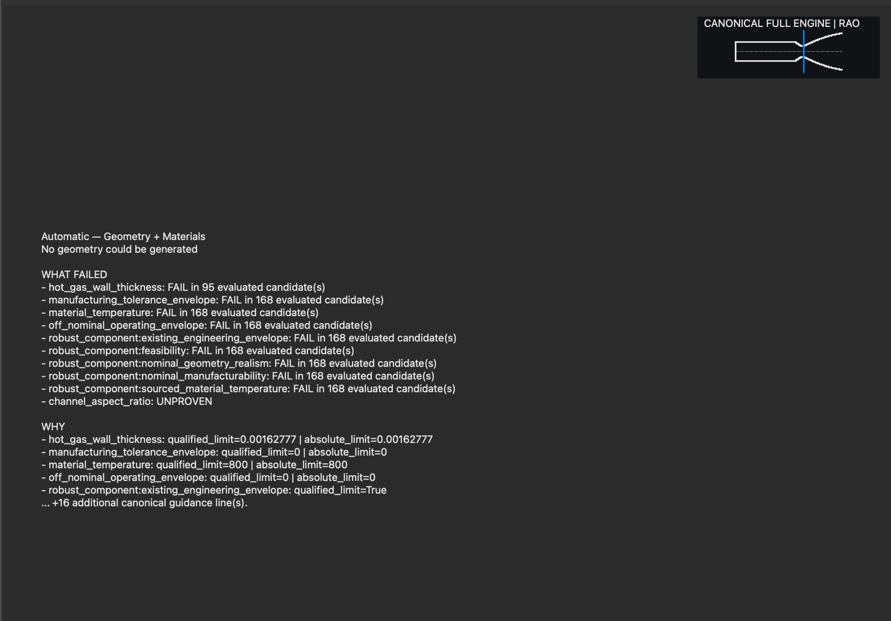

```
# LEAF — Liquid Propulsion Engine Analysis and Design Framework

## Work in Progress — Engineering Demonstrator

> **Development status:** LEAF is actively under development. The current application demonstrates thermochemical, chamber/nozzle, and preliminary regenerative-cooling analysis. Automatic regenerative-cooling geometry/material qualification is not yet established as a fully validated end-to-end capability. Outputs are preliminary engineering results, not flight-qualified designs.

LEAF (Liquid Propulsion Engine Analysis and Design Framework) is a modular liquid-rocket-engine engineering analysis environment written in Python and PySide6.

This engineering demonstrator presents the implemented LEAF foundation and currently available engineering modules. It is intended as a working engineering demonstrator rather than a claim of complete launch-vehicle or propulsion-system coverage.

### Application overview



*The LEAF desktop interface, displaying an RP-1/LOX calculation with 25 kg/s total propellant mass flow and 8 MPa chamber pressure.*

---

## Current Demonstrator Scope

The current Modular Engine represents three engineering modules:

- Combustion Chamber
- Nozzle
- Regenerative Cooling

These modules use LEAF's common runtime, storage, validation, reporting, workflow and module infrastructure rather than independent application frameworks.

The current architectural ownership hierarchy is:

```text
Engineering Physics
    ↓
Engineering Modules
    ↓
Module Engine
    ↓
LEAF Operating System
    ↓
Repository Architecture
```

Engineering physics does not own application infrastructure, and the user interface does not own engineering equations.

---

## Principal Capabilities

The current demonstrator includes:

- NASA CEA / RocketCEA thermochemical integration
- chamber-pressure, mixture-ratio and mass-flow input handling
- fuel and oxidizer mass-flow calculation
- conical and Rao-bell nozzle geometry
- area-Mach solution
- nozzle flowfield calculation
- thrust, characteristic velocity, thrust coefficient and specific impulse
- vacuum and sea-level performance outputs
- regenerative cooling analysis
- Bartz gas-side heat-transfer modelling
- coolant-side heat-transfer and hydraulic calculations
- wall-temperature and heat-flux calculations
- axial cooling-channel marching
- cooling-channel geometry validation
- engineering validation and diagnostic reporting
- Main Outputs
- Graph Explorer
- Station Table
- Regenerative Cooling Cross-Section Viewer
- report viewing
- canonical project/design save and reload

Graph Explorer evaluations use the real LEAF calculation path. A plotted X point represents a calculation rather than an interpolated substitute.

### Graph Explorer — comparative propulsion analysis



*Comparative parameter sweep for LOX with methane, hydrogen and RP-1/kerosene. Curves represent calculations under the selected graph settings, not independently validated engine designs.*

### Station Table — inspectable axial results



*Axial station data and diagnostics for a developmental regenerative-cooling case. The displayed hot-wall-temperature failures are part of the result, not successful thermal qualification.*

### Regenerative Cooling Cross-Section Viewer



*Cross-section visualisation in Manual / Unproven mode. The pictured geometry has not passed the complete coupled-design or source-qualification checks; the viewer also reports unavailable axial topology evidence.*

### Engineering reference databases



*Materials reference, including source-quality indicators, available property records and comparison tools.*



*Propellant reference, showing chemistry, property information and comparative records.*

---

## Validated Environment

The current demonstrator release has been validated on:

```text
Platform:       macOS 15.6
Architecture:   arm64
Python:         CPython 3.12.13
```

Validated Python dependencies:

```text
PySide6==6.11.1
numpy==2.4.6
scipy==1.17.1
matplotlib==3.10.9
rocketcea==1.2.3
```

These exact dependencies are recorded in:

requirements.txt

RocketCEA includes native compiled components. The validated macOS environment uses Homebrew GCC runtime support, including libgfortran.

Other operating systems and Python versions should not be treated as release-certified unless separately verified.

---

## Installation and Getting Started

LEAF is currently distributed as a Python source-code project.
It remains under active development, and a standalone application
installer or executable is not yet available.

### Prerequisites

Before installing LEAF, ensure you have:

- **Python 3.12** (recommended; tested with CPython 3.12.13 on macOS).
- **Git** (optional; you may instead download the repository as a ZIP).
- An internet connection for downloading Python dependencies.
- A terminal or command-line environment.

RocketCEA contains compiled native components and may require
additional system libraries or development tools, depending on
the operating system.

### Step 1 — Download LEAF

Clone the repository with Git:

```bash
git clone https://github.com/liatho8913/LEAF---Liquid-propulsion-Engine-Analysis-and-design-Framework-.git
cd LEAF---Liquid-propulsion-Engine-Analysis-and-design-Framework-
```

Alternatively:

1. Open the LEAF GitHub repository.
2. Select **Code → Download ZIP**.
3. Extract the downloaded archive.
4. Open a terminal in the extracted repository folder.

All subsequent commands must be executed from the repository
root, which contains `requirements.txt` and the `leaf_qt` directory.

### Step 2 — Create a Python virtual environment

A virtual environment keeps LEAF's Python dependencies separate
from other software installed on your computer.

**macOS / Linux**

```bash
python3.12 -m venv .venv
source .venv/bin/activate
```

**Windows — PowerShell (unverified)**

```powershell
py -3.12 -m venv .venv
.\\.venv\\Scripts\\Activate.ps1
```

If PowerShell prevents activation, consult Python's virtual
environment documentation rather than changing system-wide
security settings unnecessarily.

Once activated, the virtual environment should be used for
the remaining installation and launch commands.

### Step 3 — Install Python dependencies

With the virtual environment active, run:

```bash
python -m pip install --upgrade pip
python -m pip install -r requirements.txt
```

The requirements file specifies LEAF's Python dependencies,
including PySide6, NumPy, SciPy, Matplotlib and RocketCEA.

Some packages, particularly RocketCEA, may require
platform-specific compiler or runtime support.

The independently tested macOS environment uses Homebrew GCC
runtime support, including `libgfortran`.

If an installation fails, inspect the dependency error before
attempting to change package versions.

### Step 4 — Launch LEAF

From the repository root, with the virtual environment active:

```bash
python -m leaf_qt.main
```

This is the canonical source-based launch command.

A successful launch opens LEAF's PySide6 graphical interface.

If you close the terminal and return later, reactivate your
virtual environment before launching the application again.

**macOS / Linux:**

```bash
source .venv/bin/activate
python -m leaf_qt.main
```

**Windows PowerShell (unverified):**

```powershell
.\\.venv\\Scripts\\Activate.ps1
python -m leaf_qt.main
```

### Platform Compatibility

| Platform | Installation status |
|---|---|
| macOS 15.6 (Apple Silicon / arm64) | Python 3.12.13 installation and GUI launch tested |
| Windows | Installation and functionality not yet independently verified |
| Linux | Installation and functionality not yet independently verified |

A successful installation and application launch do not establish
full engineering verification of every analysis module.

### Initial Use

After launching LEAF:

1. Familiarise yourself with the main engineering inputs.
2. Select the propellant combination and operating parameters.
3. Execute the available NASA CEA and engine calculations.
4. Inspect the resulting performance and geometry outputs.
5. Explore the Graph Explorer and Station Table.
6. Review diagnostic warnings and engineering constraint failures.
7. Save engineering work using the application's project and design facilities.

The canonical 1722 demonstration case is documented below.
Its saved project and design files may not be included in a fresh
clone if they are excluded from repository distribution.
Do not assume this example can be loaded without those files.

### Engineering Disclaimer

LEAF is experimental engineering software, intended for
research, learning and preliminary analysis.

Some calculation models, automatic design processes, material
property datasets and qualification procedures remain under
development or require additional verification.

Generated outputs must not be treated as flight-qualified
or manufacturing-ready engineering designs without appropriate
independent assessment and verification.

---

## Canonical Demonstration Case

The documented demonstrator project layout is:

```text
LEAF_Projects/
└── LEAF_Demonstrator_1722/
    └── project.leaf_project.json
```

Its baseline design is:

```text
LEAF_Designs/
└── LEAF_Demonstrator_Baseline_1722/
    ├── design.leaf_design.json
    └── engineering_state.json
```

The engineering state uses:

LEAF_PROJECT_STATE_V2

The canonical state contains eleven top-level fields covering:

- calculator inputs
- CEA inputs
- raw CEA output
- geometry inputs
- regenerative-cooling materials
- benchmark selection
- startup-health state
- design history
- current calculated results

The documented case uses repository-relative references and contains no developer-machine absolute paths. **Note:** the project/design data must be included separately when distributing this demonstrator; directories excluded by `.gitignore` are not automatically present in a fresh GitHub clone.

---

## Canonical 1722 Baseline

Representative accepted values include:

Chamber pressure                 10 MPa
Mixture ratio                    1.875
Mass flow rate                   1.15 kg/s

Thrust                           3195.311573 N
Specific impulse                 283.234638 s
Vacuum specific impulse          302.265826 s

Corrected thrust                 2879.197527 N
Corrected specific impulse       255.214070 s

Throat area                      0.0001976364224 m²
Exit area                        0.002118927583 m²
Expansion ratio                  10.72134153

Rib width                        0.001 m
Hot-gas heat flux                3577036.357 W/m²
Required wall thickness          0.0857718105 m

These values are demonstration-case reference values, not universal design targets.

---

## Demonstration Workflow

A basic demonstration sequence is:

1. Launch LEAF.
2. Open LEAF_Demonstrator_Baseline_1722.
3. Inspect the restored engineering inputs.
4. Run NASA CEA.
5. Run the LEAF calculation.
6. Inspect Main Outputs.
7. Open the Regenerative Cooling Cross-Section Viewer.
8. Inspect the Station Table.
9. Use Graph Explorer.
10. Inspect engineering reports and validation output.
11. Save to a new project/design if modifications are required.
12. Close and reopen the saved design to verify persistent engineering state.

Do not overwrite the canonical baseline when experimenting with alternative values.

### Additional GUI screenshot case (25 kg/s RP-1/LOX)

The screenshots above use a **separate development test** with 25 kg/s total propellant flow, O/F = 2.4, chamber pressure = 8 MPa, chamber contraction ratio = 3, converging half-angle = 35°, characteristic length = 1.5 m, ambient pressure = 101325 Pa, and an 80%-length RAO bell nozzle. The calculated nominal thrust was approximately **74.7 kN**. This test is **not** the canonical 1722 baseline and does **not** constitute a qualified regenerative-cooling design.

---

## Project and Design Model

LEAF separates a project from a design.

A project represents the larger engineering programme or engine family.

A design represents an individual engineering configuration within that project.

Conceptually:

Project
    ↓
one or more Designs
    ↓
engineering_state.json

User-facing canonical storage roots are:

LEAF_Projects/
LEAF_Designs/
LEAF_Reports/
LEAF_Exports/

---

## Module Architecture

Module discovery is owned by LEAF's Module Engine.

Current module definitions are stored under:

leaf_qt/module_engine/definitions/

The demonstrator contains exactly three current definitions:

combustion_chamber.module.json
nozzle.json
regen.module.json

Modules are designed as explicit, independently represented engineering units with declared contracts and dependencies.

The Module Engine owns discovery, contracts, verification and runtime representation. Individual modules should not create parallel module registries or activation systems.

---

## Design History

LEAF maintains persistent design-iteration history.

The release history architecture stores:

- iteration identity
- timestamp
- engineering input snapshot
- engineering summary
- required historical validation evidence
- diagnostics
- audit evidence

The complete current calculated result set is owned by the current engineering state rather than duplicated into every historical iteration.

The canonical demonstrator state was reduced from approximately 280 MiB to approximately 8.5 MiB by eliminating recursive and duplicate history ownership while preserving the accepted engineering result state.

---

## Engineering Validation

A software PASS and an engineering PASS are not the same thing.

LEAF may execute correctly while reporting that a particular engineering configuration fails a thermal, material, geometry or validation criterion.

Engineering gates are intentionally preserved rather than weakened to produce visually clean demonstrations.

### Automatic design — current qualification evidence



*An automatic geometry/materials search reporting that no candidate met its qualification requirements. The display includes failed wall-thickness, temperature, tolerance and robustness checks. This image is **failure diagnostic evidence**, not proof of a completed automatic design.*

For the separate 25 kg/s RP-1/LOX test, the recommended 400-station cooling analysis reported hot-wall temperatures exceeding the selected material's limit. The recommended profile and geometry should not be confused with committed, validated automatic geometry.

---

## Known Demonstrator Limitations

Some material and coating routes remain explicitly incomplete or insufficiently sourced.

States such as:

PLACEHOLDER
PARTIAL_SOURCE
INSUFFICIENT_SOURCE_MODE
NO_ACTIVE_COATING_ROUTE
SUMMARY_ONLY

should be interpreted as engineering-data limitations rather than silently promoted to validated data.

Regenerative-cooling/material configurations may therefore produce engineering FAIL results. The automatic geometry-and-materials workflow currently does not demonstrate a fully qualified design for the screenshot case.

The current release does not claim validated implementation of:

- injector design
- turbopump design
- complete propellant-feed-system analysis
- combustion-instability prediction
- full structural finite-element analysis
- vehicle trajectory analysis

Those capabilities are outside this demonstrator release.

---

## Repository Boundary

Runtime release content is centred on:

leaf_qt/
cea_integration/
requirements.txt

along with the canonical demonstration project/design required for the release.

Development-maintenance, historical evidence, quarantine, archive and IDE/environment directories are not part of the clean distributable runtime surface.

Examples include:

project_maintenance/
project_evidence/
_leaf_legacy_reduction_archive/
_leaf_repository_cleanup_candidates/
_leaf_legacy_quarantine/
_leaf_archive/
_leaf_artifacts/
_external_repository_quarantine/
.idea/
.venv/

---

## Development Philosophy

LEAF follows several permanent architectural rules:

- foundations before features
- one canonical owner for each concept
- engineering physics remains separate from infrastructure
- modules remain explicit and replaceable
- reuse existing owners before introducing new systems
- replace superseded mechanisms rather than accumulating compatibility layers indefinitely
- automate repeated integration work
- treat repository health as an engineering concern

The intended direction is that adding future engineering modules requires progressively less application-wide integration work.

---

## Release Status

This repository is a **work-in-progress engineering demonstrator** and is currently in demonstrator release preparation.

Programme 40 established the accepted live demonstrator.

Release-freeze work has subsequently:

- captured the validated environment
- established a portable canonical demonstration case
- verified clean launch/save/reload behaviour
- removed embedded development debris from the production namespace
- consolidated design-history ownership
- reduced the portable engineering state from approximately 280 MiB to approximately 8.5 MiB
- proved compact linear history growth through live save/reload calculations

Final clean release staging and package-integrity verification remain before the demonstrator release is considered frozen.

```